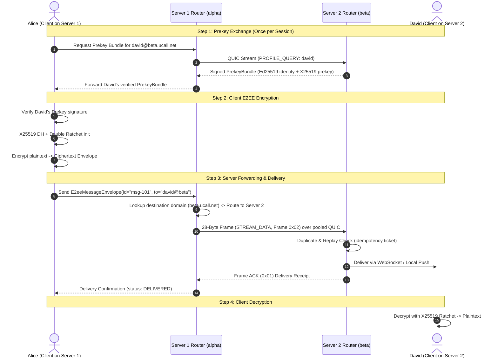
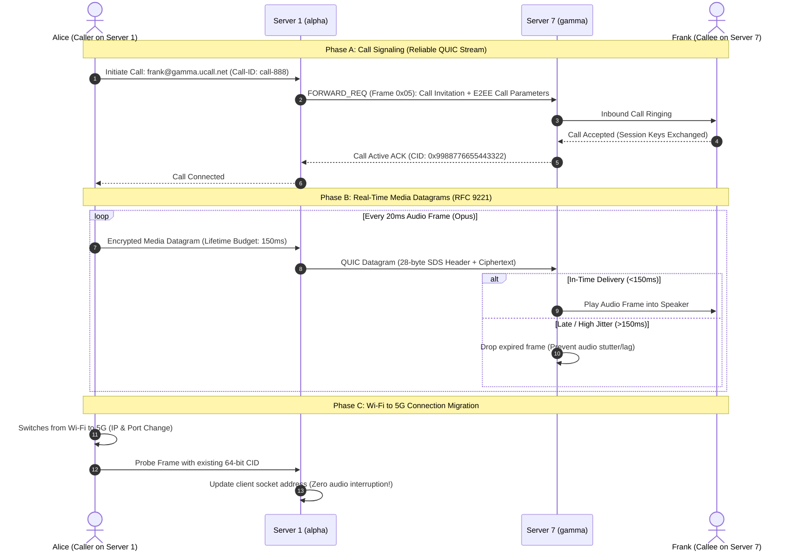
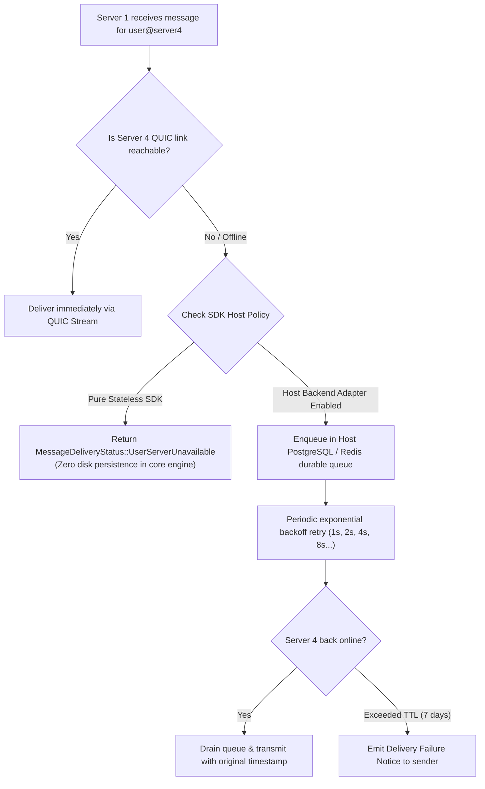

# UCall SDS — Multi-Server, Multi-User Federation Architecture & Operational Guide

**Document Version:** 1.0 (Production Architecture Standard)  
**Scope:** 1 Server with Multiple Users Communicating with 10 Autonomous Servers (Mesh Federation)  
**Target Systems:** UCall Mobile/Web Apps, SDS Core Engine (`sds-sdk`), Host Backends (Node.js/Postgres/MySQL)  
**File Location:** `/Users/malleravindra/Projucts/PingDart Chat/UcallSDS/MULTI_SERVER_MULTI_USER_FEDERATION_GUIDE.md`  

---

## 1. System Overview & The Multi-Server Mesh

In a traditional messaging and calling architecture, developers typically face two extremes:
1. **The Centralized Model (WhatsApp, Telegram, Slack):** All users connect to one company's central server. If that central server or cloud provider goes down, all communications stop.
2. **Heavy Federated Models (Matrix / Synapse):** Every server syncs massive JSON state databases, leading to database bloat, state resolution lag, and multi-second call setup delays.

**UCall SDS uses an Autonomous Sovereign Mesh:**
* **Server 1** (`alpha.ucall.net`) hosts its own local users (e.g. Alice, Bob, Charlie, and hundreds more).
* **Servers 2 through 11 (10 Remote Servers)** each run autonomously with their own domain names, independent user bases, independent databases, and independent Ed25519 identity keypairs.
* **Stateless Transport Core:** Neither Server 1 nor any remote server shares a central database. Communication flows over multiplexed **QUIC (RFC 9000)** connections and low-latency **QUIC Datagrams (RFC 9221)** with End-to-End Encryption (E2EE).

```
 ┌────────────────────────────────────────────────────────────────────────────────────────┐
 │                                   SERVER 1 (alpha.ucall.net)                          │
 │  Local Users: Alice, Bob, Charlie, ... (PostgreSQL / Redis / WebSocket Gateway)        │
 │  SDS Authority Key: Ed25519 (Pub: 7a8f...3c)  | Domain ID: ALPHA11223                   │
 └─────────────┬───────────────────────────┬────────────────────────────┬─────────────────┘
               │ QUIC Pool (Session CID)   │ QUIC Pool (Session CID)    │ QUIC Pool ...
               ▼                           ▼                            ▼
 ┌───────────────────────────┐ ┌───────────────────────────┐ ┌───────────────────────────┐
 │   SERVER 2 (beta.ucall)   │ │   SERVER 3 (gamma.ucall)  │ │   SERVER 11 (omega.ucall) │
 │ Local Users: David, Eve.. │ │ Local Users: Frank, Grace │ │ Local Users: Zara, Liam.. │
 │ SDS ID: BETA223344        │ │ SDS ID: GAMMA33445        │ │ SDS ID: OMEGA99001        │
 └───────────────────────────┘ └───────────────────────────┘ └───────────────────────────┘
```

---

## 2. Global Addressing & Discovery (How Users Find Each Other)

### 2.1 Uniform User Addressing
Every user across all servers has a globally unique URI:
```text
alice@alpha.ucall.net      <── User Alice hosted on Server 1
david@beta.ucall.net       <── User David hosted on Server 2
frank@gamma.ucall.net      <── User Frank hosted on Server 3
zara@omega.ucall.net       <── User Zara hosted on Server 11
```
Alternatively, compact 10-character SDS Domain Identifiers can be used:
```text
david#BETA223344
```

### 2.2 Three-Step DNS & Cryptographic Discovery Pipeline
When Alice (`alice@alpha.ucall.net`) wants to message or call David (`david@beta.ucall.net`), Server 1 discovers Server 2 automatically without any central phonebook or directory:

```
Alice                   Server 1 (alpha)             Public DNS             Server 2 (beta)
  │                            │                          │                        │
  │── Send to david@beta ─────▶│                          │                        │
  │                            │── 1. Query SRV & TXT ───▶│                        │
  │                            │   _sds._udp.beta.ucall   │                        │
  │                            │◀── Return 10 10 4433 ────│                        │
  │                            │    host: quic.beta.ucall │                        │
  │                            │                          │                        │
  │                            │── 2. Authenticate Server Identity (Ed25519) ─────▶│
  │                            │◀── Return Signed SdsEndpointRecord ───────────────│
  │                            │    (host:port, pubkey, signature)                 │
  │                            │                                                   │
  │                            │── 3. Establish Multiplexed QUIC Connection ──────▶│
```

1. **DNS SRV & TXT Query:**
   Server 1 checks DNS for `_sds._udp.beta.ucall.net`:
   * `SRV`: Priority `10`, Weight `10`, Port `4433`, Target `quic.beta.ucall.net`.
   * `TXT`: Public Ed25519 Identity Key and SDS ID (`v=sds1; id=BETA223344; k=ed25519:...`).
2. **Cryptographic Endpoint Verification:**
   Server 2 presents an `SdsEndpointRecord` signed by Server 2's authority private key. Server 1 verifies the signature against the DNS public key. This completely prevents DNS spoofing and Man-In-The-Middle (MITM) attacks.
3. **Connection Pooling:**
   Once verified, Server 1 maintains **one pooled QUIC connection** to Server 2. Thousands of user messages and call sessions between Server 1 and Server 2 share this single multiplexed QUIC pipe.

---

## 3. Multi-User Messaging Flow (Step-by-Step)

Here is how Alice (on Server 1) sends an E2EE direct chat message to David (on Server 2):



### Why Neither Server Can Read or Tamper With Messages
1. **Zero-Knowledge Servers:** Alice's client encrypts the message payload using David's authenticated X25519 prekey before it ever leaves her phone. Server 1 and Server 2 only route the ciphertext bytes.
2. **Anti-Replay Gating:** Each message envelope has a unique ID and monotonic ratchet sequence number. If an attacker intercepts and resends the frame, Server 2’s `DistributedReplayStore` rejects it immediately with error code `0x0002` (`ERR_REPLAY_DETECTED`).

---

## 4. Multi-User Real-Time Audio & Video Call Flow

Real-time audio/video calls require sub-100ms latency. TCP and standard HTTP/WebSocket are unsuitable because packet loss causes Head-of-Line (HoL) blocking.

UCall SDS uses a dual-channel QUIC model:
1. **Control / Signaling Channel (Reliable QUIC Stream):** Call setup, ringing, accept, hangup, and cryptographic session key negotiation.
2. **Media Channel (Unreliable QUIC Datagrams - RFC 9221):** Opus audio and VP9/AV1 video packets packaged inside lightweight 28-byte SDS binary frames.



### 4.1 Playout Lifetime Budget (Jitter Control)
In real-time calling, a delayed packet is useless. If an audio packet arrives 200ms late, playing it causes echo and stutter.
* Every SDS media frame header includes an exact **32-bit Playout Timestamp** and **16-bit Lifetime Limit (ms)**.
* If `elapsed > lifetime_limit_ms`, the receiver drops the frame immediately to preserve smooth conversation timing.

### 4.2 Seamless Connection Migration (Zero Dropped Calls)
When Alice walks outside and her phone switches from home Wi-Fi (`192.168.1.50:52130`) to 5G mobile data (`172.56.21.9:61204`):
* Traditional TCP/WebSockets drop the call because the IP/Port pair changed.
* SDS uses a **persistent 64-bit Connection ID (CID)** in the QUIC header. When packets arrive from the new IP, Server 1 recognizes the CID, updates the routing table, and the call continues without disconnecting.

---

## 5. Scaling: Server 1 Calling & Messaging Across 10 Servers Simultaneously

When Server 1 has hundreds of local users talking to users distributed across 10 different servers (`Server 2` through `Server 11`):

```
                               ┌─────────────┐
                         ┌────▶│  Server 2   │ (15 active calls, 40 msg/s)
                         │     └─────────────┘
                         ├────▶│  Server 3   │ (8 active calls, 12 msg/s)
                         │     └─────────────┘
                         ├────▶│  Server 4   │ (30 active calls, 95 msg/s)
                         │     └─────────────┘
    ┌──────────────┐     ├────▶│  Server 5   │ (0 calls, 2 msg/s)
    │   SERVER 1   │─────┼────▶│  Server 6   │ ...
    │ (alpha.ucall)│     ├────▶│  Server 7   │ ...
    │              │     ├────▶│  Server 8   │ ...
    └──────────────┘     ├────▶│  Server 9   │ ...
                         ├────▶│  Server 10  │ ...
                         │     └─────────────┘
                         └────▶│  Server 11  │ (5 active calls, 18 msg/s)
                               └─────────────┘
```

### 5.1 Efficient QUIC Connection Multiplexing
Server 1 **does not** create a new socket connection for every single message or call.
* It maintains a **Connection Pool** of exactly 1 active QUIC connection per peer server.
* Inside that single QUIC connection:
  * Up to **thousands of independent bidirectional streams** run simultaneously for text messages, profile queries, and call signaling.
  * Millions of **unreliable datagrams** flow concurrently for active voice and video streams, tagged with individual stream IDs.

### 5.2 Multi-Party Group Messaging (Broadcast Fan-Out)
If Alice on Server 1 sends a message to a group chat containing 10 users spread across 10 servers:
* **Inefficient Client-Side Upload (Bad):** Alice's phone uploads the media file 10 times over her cellular connection.
* **SDS Federated Server-Side Fan-Out (Optimized):**
  1. Alice encrypts the payload once using a group Sender Key (SFrame / MLS standard).
  2. Alice uploads the single encrypted envelope to Server 1.
  3. Server 1 looks up the 10 member domains and transmits **1 copy over the pooled QUIC connection to each of the 10 target servers**.
  4. Each remote server locally delivers the message to its own users.
  5. Result: 90% savings in client bandwidth and mobile battery life.

---

## 6. Offline Delivery & Failure Recovery Across the Mesh

What happens if Server 4 or Server 9 goes temporarily offline (e.g., server maintenance, power outage, or network partition)?



* **Stateless Safety Guarantee:** The `sds-sdk` binary core never retains unsent messages on disk. If Server 1 restarts, no uncommitted memory files are corrupted. All durable queuing is managed explicitly by the host application’s database adapter.
* **Duplicate Suppression:** When Server 4 comes back online and Server 1 flushes its backlog, Server 4 checks each message against its idempotency cache. If a message was already acknowledged before the crash, Server 4 returns `MessageDeliveryStatus::DuplicateIgnored` and discards the duplicate.

---

## 7. Concrete Code Implementation: Setting Up a 10-Server Mesh

Here is how to configure and run multi-server routing using the Rust SDK (`sds-sdk`):

```rust
use sds_core::federation::*;
use sds_core::identity::SdsIdentityKeyPair;
use sds_core::e2ee::*;
use std::net::SocketAddr;

fn main() -> anyhow::Result<()> {
    // 1. Initialize Server 1 Authority Identity & Federation Router
    let server1_authority = SdsIdentityKeyPair::generate();
    let mut router1 = FederationRouter::new("alpha.ucall.net");

    // 2. Register Local Users on Server 1
    router1.register_local_user("alice");
    router1.register_local_user("bob");
    router1.register_local_user("charlie");

    // 3. Register Peer Servers 2 through 11 in the Mesh
    let peer_servers = vec![
        ("beta.ucall.net",    "BETA223344",  "198.51.100.2:4433"),
        ("gamma.ucall.net",   "GAMMA33445",  "198.51.100.3:4433"),
        ("delta.ucall.net",   "DELTA44556",  "198.51.100.4:4433"),
        ("epsilon.ucall.net", "EPSILON556",  "198.51.100.5:4433"),
        ("zeta.ucall.net",    "ZETA667788",  "198.51.100.6:4433"),
        ("eta.ucall.net",     "ETA7788990",  "198.51.100.7:4433"),
        ("theta.ucall.net",   "THETA88990",  "198.51.100.8:4433"),
        ("iota.ucall.net",    "IOTA990011",  "198.51.100.9:4433"),
        ("kappa.ucall.net",   "KAPPA00112",  "198.51.100.10:4433"),
        ("omega.ucall.net",   "OMEGA11223",  "198.51.100.11:4433"),
    ];

    for (domain, sds_id, addr_str) in peer_servers {
        let addr: SocketAddr = addr_str.parse()?;
        router1.register_peer_node(domain, sds_id, Some(addr));
    }

    println!("[✓] Server 1 Federation Router initialized with 10 peer nodes.");

    // 4. Simulate Alice sending a message to David on Server 2 (beta.ucall.net)
    let recipient_bundle = PrekeyBundle {
        identity_key: "0102030405060708090a0b0c0d0e0f101112131415161718191a1b1c1d1e1f20".to_string(),
        signed_prekey: "aabbccddeeff00112233445566778899aabbccddeeff00112233445566778899".to_string(),
        signature: "1122334455667788...".to_string(),
    };

    let envelope = E2eeMessageEnvelope::encrypt_for_recipient(
        "alice@alpha.ucall.net",
        "david@beta.ucall.net",
        &recipient_bundle,
        b"Hello David! Greetings from Server 1.",
        1,
        1_700_000_100_000,
    )?;

    // 5. Route Envelope: Server 1 detects recipient is on beta.ucall.net and queues for QUIC
    let status = router1.route_envelope("msg-uuid-001", "beta.ucall.net", envelope);
    println!("Delivery Status: {:?}", status);
    // => MessageDeliveryStatus::QueuedForFederatedServer

    Ok(())
}
```

---

## 8. Summary Checklist for Production Deployment

| Area | Best Practice | Status in UCall SDS |
|---|---|:---:|
| **DNS Configuration** | Set up `_sds._udp.<domain>` SRV and TXT authority records for all 10 servers. | Automated via `sds dns-setup <domain>` wizard |
| **Port Forwarding / Firewall** | Open UDP port `4433` (or chosen port) for inbound/outbound QUIC traffic. | Standard UDP socket listener |
| **Connection Pooling** | Maintain 1 QUIC session per server pair, multiplexing streams and datagrams. | Handled in `sds-transport` |
| **E2EE Privacy** | Prekey bundle signature verification and double-ratchet payload encryption. | Handled in `sds_core::e2ee` |
| **Voice & Video Latency** | RFC 9221 Unreliable Datagrams with 150ms playout lifetime drop budget. | Handled in `sds_core::transport` |
| **Network Migration** | 64-bit session Connection ID (CID) to sustain calls across Wi-Fi/5G switches. | Built into QUIC protocol engine |
| **Offline Durability** | Retain zero local disk state in SDK; persist offline queues in Postgres/Redis. | Enforced by pure stateless architecture |

